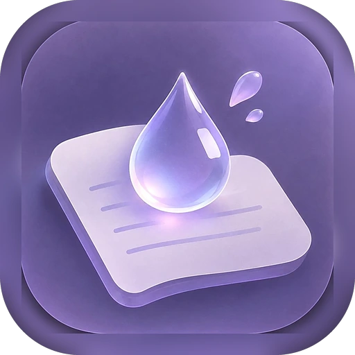

# 小雨点 · Xiaoyudian

> 极简、纯本地的 Android 便签应用 · 记录每一个念头。

**没有网络权限，没有账号，没有广告，没有第三方 SDK。** 所有内容只保存在你自己的手机上。



## 特性

| 记录 | 整理 | 外观 |
|---|---|---|
| 富文本（粗体 / 斜体 / 下划线 / 删除线） | 置顶 | 纯白 / 纯黑主题 |
| 正文内嵌图片，可点开缩放 | 分类文件夹（自定义图标颜色） | 自定义主色 + 明度调节 |
| 位置标注（只显示城市，点开看完整地址） | 回收站（可还原 / 彻底删除） | 四档字号 |
| 自动记录最后修改时间 | 全文搜索 | 列表 / 详情两种视图 |

**数据管理**：一键导出 / 导入完整备份（便签、图片、头像、昵称、签名、语言、主题、字号全部包含），也可以开启自动备份。换手机等于搬家。

**多语言**：简体中文 / 繁體中文 / English / 日本語 / 한국어。

## 构建

本项目**不使用 Gradle**，用脚本直接调用 Android 构建工具链，产物是一个很小的 APK（约 218 KB）。

需要准备：

- JDK 17
- Android SDK Build-Tools **35.0.1**（`aapt2`、`d8`、`zipalign`、`apksigner`）
- Android Platform **android-35**（`android.jar`）
- Python 3 + Pillow（仅用于生成图标）

把以上路径写进 `build.ps1` 顶部的变量，然后：

```powershell
$env:KS_PASS = "你的签名口令"
./build.ps1
```

产物在 `build/小雨点.apk`。首次运行会自动生成一个自签名 keystore（`keystore/` 目录，**不会被提交**）。

> 只有 Windows 脚本。macOS / Linux 用户需要按 `build.ps1` 的步骤手写一份 shell 版本。

## 目录结构

```
app/
 ├─ AndroidManifest.xml
 ├─ src/com/xiaoyudian/notes/   ← 全部 Java 源码
 └─ res/                        ← 图标、颜色、样式
tools/
 ├─ pack.py                     ← 把资源与 dex 打包成 APK
 ├─ icons.py                    ← 生成各密度图标
 └─ icon_master.png             ← 图标母版
build.ps1                       ← 构建脚本
```

## 数据与隐私

- 未申请 `INTERNET` 权限，技术上无法上传任何数据
- 图片、定位、备份都只在本机处理
- 详见应用内「关于 › 隐私政策」

## 许可证

GPL-3.0。任何基于本项目的衍生作品需以同样协议开源。

## 反馈

请提 Issue。提 Bug 时请附上：机型和 Android 版本、复现步骤、截图。